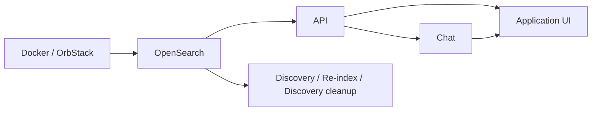

# CatalogueSearch — Onboarding Guide

## Overview

CatalogueSearch is a search system for multilingual (Hindi/Gujarati) PDF documents, primarily targeted towards Spiritual scriptures and discourses. It processes two document types via different pipelines:

- **Discourses** — list of fairly structured PDF text files
- **Scriptures** — unstructured / semi-structured text files

See [ARCHITECTURE.md](ARCHITECTURE.md) for a full design overview.

---

## Onboarding / Setup

This section lists the prerequisites required to setup your laptop to get **cataloguesearch** up and running.

### OrbStack (Docker runtime)

This project uses [OrbStack](https://orbstack.dev/) as the Docker runtime on macOS. Install it and ensure it's running before any `docker compose` commands.

### Homebrew packages

```bash
brew install tesseract tesseract-lang poppler
```

Verify Tesseract has Hindi and Gujarati:
```bash
tesseract --list-langs    # should include hin and guj
```

### Python 3.13+

```bash
python3 --version    # must be 3.13+
```

### Tessdata (Hindi & Gujarati)

Download high-quality trained models from `tesseract-ocr/tessdata_best` into the repo's `tessdata/` directory:

```bash
mkdir -p tessdata
curl -L -o tessdata/hin.traineddata https://github.com/tesseract-ocr/tessdata_best/raw/main/hin.traineddata
curl -L -o tessdata/guj.traineddata https://github.com/tesseract-ocr/tessdata_best/raw/main/guj.traineddata
```

These are used automatically — `configs/config.yaml` already points `tessdata_dir` to this folder.

### API Keys

You will need the following keys. Get them from a colleague or create your own:

| Key | Where used                                      |
|-----|-------------------------------------------------|
| `GEMINI_API_KEY` | Granth crawling (LLM OCR + bookmark extraction) |
| `RECAPTCHA_SECRET_KEY` + `REACT_APP_RECAPTCHA_SITE_KEY` | Feedback form UI                                |
| `BREVO_API_KEY` | Email delivery for feedback                     |
| `GOOGLE_CLIENT_ID` + `REACT_APP_GOOGLE_CLIENT_ID` (same value) | Google Sign-In (login + chat history) — see [Google OAuth setup](#google-oauth-setup-login) below |
| `JWT_SECRET` | Signs/verifies the login session cookie — generate your own, don't reuse a colleague's (see below) |

### Google OAuth setup (login)

`cataloguesearch` and `cataloguesearch-chat` share one login system: this repo issues the session (via Google Sign-In), `cataloguesearch-chat` just verifies it. Both need a piece of this setup.

1. **Create or reuse a Google Cloud project.** [console.cloud.google.com](https://console.cloud.google.com/) — the project behind `GEMINI_API_KEY` works fine too, no need for a separate one.
2. **Configure the OAuth consent screen** — app name, support email. Audience: **External** (this is a public-facing app, not restricted to a Workspace org). Scopes: `openid`, `email`, `profile` only — these are non-sensitive, so Google never requires a manual review for them.
3. **Create an OAuth 2.0 Client ID** — type **Web application**. Under **Authorized JavaScript origins**, add every host that will actually serve the frontend and run this login flow from — typically `http://localhost:3000` for local dev, plus your real domain(s) in prod (e.g. `https://swalakshya.me`, `https://chat.swalakshya.me`). One Client ID can hold multiple origins (up to 15) — you don't need a separate one per environment. Leave **Authorized redirect URIs** blank: this flow uses Google's client-side Sign-In button, which hands back an ID token directly to the frontend, no server-side redirect involved.
4. Copy the **Client ID** (looks like `1234567890-abc...apps.googleusercontent.com`) — that's your `GOOGLE_CLIENT_ID` / `REACT_APP_GOOGLE_CLIENT_ID`. You don't need the Client Secret for this flow.
5. While the consent screen is in **Testing** mode, only Google accounts you've explicitly added as test users can log in (up to 100). Flip it to **Production** — no review needed for these scopes — once you want any Google account to be able to sign in.
6. **Generate a `JWT_SECRET`** — a random signing key, not something tied to Google at all:
   ```bash
   openssl rand -hex 32
   ```
   This exact value needs to go in **both** repos: `cataloguesearch/.env.local` and `cataloguesearch-chat/service/.env.local` (see that repo's own `.env.local.example`) — both services verify the same signed cookie, so they have to agree on the secret. It's not a Google credential, so generate it yourself rather than asking a colleague for theirs.
7. For the chat service to actually persist sessions (needed for chat history to work at all), `cataloguesearch-chat/service/.env.local` also needs `CHAT_DB_PATH` set — see that repo's README for details. Easy to miss locally since nothing else in that service depends on it.

---

## One-Time Setup

### 1. Clone required repositories

```bash
git clone https://github.com/swalakshya/cataloguesearch
git clone https://github.com/swalakshya/cataloguesearch-configs
git clone https://github.com/swalakshya/varnmala-io
```

Set up `varnmala-io` per its own [README](https://github.com/swalakshya/varnmala-io). Place all three repos as siblings in the same parent directory.

### 2. Create environment files

**`.env.local`** (repo root) — used by `docker compose` and `discovery_cli.py`:

```bash
DOCKER_PLATFORM=linux/arm64        # linux/amd64 on Intel
OPENSEARCH_JAVA_OPTS=-Xms1g -Xmx1g
OPENSEARCH_INITIAL_ADMIN_PASSWORD=Admin@Password123!
RESTART_POLICY=no
LOG_LEVEL=VERBOSE
API_HOST=0.0.0.0
API_PORT=8000
OPENSEARCH_HOST=localhost
REACT_APP_API_BASE_URL=http://localhost:8000/api
REACT_APP_EVAL_API_BASE_URL=http://localhost:8001/api
REACT_APP_RECAPTCHA_SITE_KEY=<key>
RECAPTCHA_SECRET_KEY=<key>
BREVO_API_KEY=<key>
FEEDBACK_FROM_EMAIL=contact@swalakshya.me
FEEDBACK_TO_EMAIL=contact@swalakshya.me
GEMINI_API_KEY=<key>
BROWSER=none

# Google login + session auth — see "Google OAuth setup" above
GOOGLE_CLIENT_ID=<client-id>.apps.googleusercontent.com
REACT_APP_GOOGLE_CLIENT_ID=<client-id>.apps.googleusercontent.com
JWT_SECRET=<openssl rand -hex 32>

# Optional: throttle CPU/heat during indexing (tune for your machine)
OCR_MAX_WORKERS=4        # parallel Tesseract processes; 2 for fanless, 4-8 for fan-cooled
EMBEDDING_BATCH_SIZE=4   # texts per embedding batch; lower = less CPU burst
TORCH_NUM_THREADS=4      # PyTorch CPU threads; 0 = PyTorch decides (all cores)
```

Create a symlink inside `frontend/` so that `npm start` picks up the same file:

```bash
ln -s ../.env.local frontend/.env.local
```

**`tests/.env`** — used by the test suite:

```bash
ROOT_DIR=/path/to/cataloguesearch
TEST_BASE_DIR=${ROOT_DIR}/tests
TEST_DATA_DIR=${TEST_BASE_DIR}/data
PATH=$PATH:/opt/homebrew/bin:/opt/homebrew/sbin
INDEX_NAME="opensearch-index-pytest"
GEMINI_API_KEY=<key>
```

### 3. Set up Python environment

```bash
cd cataloguesearch
python3 -m venv venv
source venv/bin/activate
pip install -r requirements.txt
```

### 4. Build the ONNX reranker model

**Required before the first Docker build.** The API image bundles this model at build time.

`optimum-cli` is installed as part of `requirements-base.txt` (via `optimum[onnxruntime]`), so activate your venv first:

```bash
source venv/bin/activate
mkdir -p models && cd models
optimum-cli export onnx --model BAAI/bge-reranker-base --opset 18 bge-reranker-base-onnx
cd ..
# produces: models/bge-reranker-base-onnx/
```

This downloads `BAAI/bge-reranker-base` from HuggingFace (~1.1GB) and converts it to ONNX. Only needs to be done once (or when the model changes).

> **Note:** The command may end with a `FileNotFoundError: model.onnx.data` traceback — this is a harmless bug in optimum's cleanup code (naming mismatch between the PyTorch dynamo exporter and optimum). The export itself completes successfully; ignore the error and verify with `ls models/bge-reranker-base-onnx/` — you should see `model.onnx`, `model.onnx_data`, and tokenizer files.

### 5. Build Docker images

```bash
docker compose --env-file .env.local build
```

### 6. Get an OpenSearch snapshot and restore it

Ask a colleague for the `snapshots/` directory and place it at the repo root. Then:

```bash
# Start OpenSearch
docker compose --env-file .env.local up opensearch -d

# Interactive restore (walks through each step)
./scripts/restore_snapshots.sh snapshots
```

This restores three indices: `cataloguesearch_prod`, `cataloguesearch_prod_metadata`, `cataloguesearch_prod_granth`.

Verify:
```bash
curl localhost:9200/cataloguesearch_prod/_count
curl localhost:9200/cataloguesearch_prod_metadata/_count
curl localhost:9200/cataloguesearch_prod_granth/_count
```

---

## Running the Stack

```bash
docker compose --env-file .env.local up -d
```

| Service | URL |
|---------|-----|
| Frontend | http://localhost:3000 |
| Search API | http://localhost:8000 |
| OpenSearch | http://localhost:9200 |

### Running without Docker (development)

Useful when iterating on the backend or frontend without rebuilding images. OpenSearch still needs to be running via Docker.

```bash
# API server
source venv/bin/activate
uvicorn backend.api.search_api:app --env.file .env.local --host 0.0.0.0 --port 8000 --reload

# Frontend (separate terminal)
cd frontend && npm start
```

---

## Eval UI

The eval UI is a local-only tool for inspecting OCR output, paragraph generation quality, and LLM-extracted bookmarks. It runs as a separate server on port 8001.

```bash
# Start the eval server
source venv/bin/activate
uvicorn eval.api:app --host 0.0.0.0 --port 8001 --reload
```

Access it at http://localhost:3000/eval (via the frontend).

### Dev server: `/dev` homepage, Discover and Deploy

**Standalone dashboard (recommended):** the dev UI and its API share
`http://localhost:4000/dev`. It runs from the existing Python virtualenv without Docker,
OpenSearch, the application API/chat, a Vite server or any application UI process. Initial UI
compilation needs the frontend's installed Node/npm build tools; normal startup does not.

```bash
cd /Users/rjain/github/swalakshya/cataloguesearch
/Users/rjain/venv/3.13_swalakshya/bin/python dashboard.py --build
/Users/rjain/venv/3.13_swalakshya/bin/python dashboard.py
```

Build once, then use only the final command on subsequent starts. Stop with Ctrl+C. The launcher
owns one Uvicorn child (no `--reload`), binds only to `127.0.0.1`, and rejects a second launcher.
The application remains separate at port 3000. The same virtualenv and local dev data used by
the old port-8001 server are reused; stop that old server before running the new launcher so two
servers do not manage the same jobs. Existing npm/Vite development remains supported separately.

Saving Python or frontend source changes shows **Update available** in the Dev bar within a few
seconds. Nothing updates until you click. The update pauses new work, waits for deployment,
discovery, maintenance, queued/running Eval OCR jobs, load tests, Drive authorization and in-flight API requests to finish,
then rebuilds changed UI assets and gracefully restarts the dashboard. Status and cancellation
remain available while waiting. Open tabs reload after reconnecting to the new server instance.
Python-only updates do not invoke npm. Updating UI code requires Node/npm to be available on PATH;
it never installs packages automatically. A failed UI build or backend syntax/import validation leaves the old dashboard running and
allows retry. Editing code during a build also aborts the update so a mixed version is not applied.

Bundles, the current-release pointer, update state and a launcher lock live under the ignored
`.dashboard/` folder. Assets use versioned URLs so older browser tabs can still load their files
after an update. Bundles are kept until explicitly removed; their size depends on the compiled UI.
Missing `/api/*` routes return API errors rather than the dashboard HTML. Docker and external
service checks can report unavailable independently while the dashboard itself remains usable.
For automatic startup at boot, install the macOS system service once:

```bash
/Users/rjain/venv/3.13_swalakshya/bin/python /Users/rjain/github/swalakshya/cataloguesearch/scripts/install_dashboard_service.py
```

The installer prompts for the Mac administrator password. It registers
`com.swalakshya.dashboard` in `/Library/LaunchDaemons`, runs the dashboard as your
regular account, and restarts it if it exits. The dashboard can remain available
while your account is logged out or another account is in use. This starts only
the dashboard UI and dev API; application services remain browser-controlled.
Logs are `.dashboard/service.stdout.log` and `.dashboard/service.stderr.log`.

For a supervised service limited to the current login, use the same command with
`--session` (no administrator password). That service ends at logout and is
replaced automatically when the system installer runs. A manual foreground
`python dashboard.py` process must be stopped before installing either service;
these commands never kill an unrelated listener on port 4000.

### Dashboard navigation

The dashboard separates **🧑‍💻 Dev** (laptop tools) from **🌍 Prod** (the production VM).
Dev contains Local services, Discovery, Deploy, Cleanup and Eval tools. Laptop/Google Drive backups
are linked from the Dev home page. Prod contains Overview, Services, Certificates, Backups & restore,
Cleanup and Host maintenance. Old `/services`, `/discover`, `/eval` and `/deploy?tab=…` URLs redirect
and preserve evaluation/discovery query parameters.

Production overview reads a short CPU sample, available-memory usage, root disk usage, uptime,
container image tags/IDs and the last deployment job. Host maintenance shows Ubuntu, kernel, Docker,
cached package updates and reboot-required state. These checks do not update or restart the VM.
Production service controls distinguish restart with current images from pull & recreate; both require
explicit typed confirmation in the UI. Snapshot visibility lists registered OpenSearch repositories;
restore uses the existing staged-snapshot workflow and its production confirmation. These snapshots do
not cover application databases or VM backups. Cleanup pages are fixed to their Dev or Prod target.

### Local service controls

Open `http://localhost:4000/services` (Services in the Dev bar). **Start development** starts
OrbStack/Docker, the existing `opensearch` Compose service, the native Python API, native Node
chat service, then the built application UI at port 3000. Dependencies are checked for readiness
before continuing. Docker and the OpenSearch image must already be installed locally; this page
does not pull/build images, fetch Git changes or install Python/Node packages. The API uses the
dashboard's virtualenv; chat uses the sibling repo's `service/` and its installed Node dependencies.

The local dependency graph (arrows run from prerequisite to consumer) is:



Individual Start, Restart and Update actions prepare their dependencies first. Discovery jobs have a
visible **Prepare Docker and OpenSearch** step before any file processing, including OCR-only runs:
the current OCR CLI initializes and checks OpenSearch even without indexing. If startup fails or is
cancelled, subsequent discovery steps do not run. Startup reuses healthy services and leaves them
running after the job finishes. Missing Docker/images and readiness timeouts appear in the job logs;
startup does not restart a healthy stack or build/pull container images.

Service cards use solid green **Ready**, orange **Starting / Stopped**, and red **Not ready / Failed**
badges, with explicit labels and direct dependencies shown on each card.

Individual Start/Stop/Restart controls share the existing job runner with deployment and maintenance.
Stopping a dependency stops its managed dependents first. Restart restores the target and previously
running dependents. **Stop development** leaves Docker and unrelated containers running and preserves
all stored data. Stopping/restarting Docker requires confirmation because other local containers are
affected. Docker commands reject remote Docker contexts. Processes started manually are shown as
external and may be reused when healthy; they are never killed/adopted automatically. Stop those in
their terminal before managing them here.

API runs on 127.0.0.1:8000 without `--reload`, points to local OpenSearch, and connects its chat-admin
client to localhost:8012. Chat binds to 127.0.0.1:8012, points to the local API, and shares the API's
JWT/admin configuration from the root `.env.local`. Chat-specific settings additionally come from
the sibling `service/.env.local`. The application UI is built with the local API/chat addresses and
dev dashboard routes disabled, then served on 127.0.0.1:3000 by Python. This avoids Vite hot reload
applying changes before an explicit update. Refresh the application browser tab after updating UI.

API/UI/chat show **Update available** when local source/config differs from their running revision.
**Update immediately restarts that service**; in-flight HTTP calls and chat responses can terminate.
There is no request-draining in this phase. UI Update rebuilds the UI; API/chat Update restarts with
current source/config. Detached per-service supervisors and verified process-group records survive
dashboard restarts; a stale/reused PID is never treated as a managed process.

Logs and read-only configuration are available for all five services. Configuration shows the next
start's values and source files, not a live introspection of an external process. Secret fields are
masked server-side; Show retrieves one field explicitly, uses no-store responses, and hides it again
after 30 seconds or closing the view. Configurations are not editable here. Search settings by name;
the selected service is highlighted and each dependency control describes its impact. Log retrieval
times show freshness. Logs refresh automatically every three seconds; scrolling up pauses automatic
scrolling, and Latest resumes it. Copy logs copies the retained text. Services receive a fixed
startup environment from the configuration files, without stale app settings inherited from the dashboard.
UI updates build a separate release before stopping the running UI; failed builds keep it available.
Only the two newest UI builds are retained after a successful start. Startup failures stay visible
until retried or stopped. Native console logs rotate at 4 MiB with one backup each (about 8 MiB per service); the viewer retains at most 10,000 lines or 5 MB in memory.
Managed console logs mask configured secrets, credential URLs and token fields before saving.
Application libraries may also maintain their own existing logs. Docker logs read the existing
OrbStack host runtime log without starting the VM; OpenSearch logs come from the local container.

Implementation: `deploy/services/base.py` defines the service contract and common configuration,
masking and action metadata. `DockerService` and `OpenSearchService` implement runtime/container
operations; `ProcessService` owns the shared native lifecycle, with API/Chat/UI implementations in
`applications.py`. Register implementations in dependency order in `deploy/services/__init__.py`.
`deploy/local_services.py` coordinates dependencies and jobs and retains verified process ownership.
The existing HTTP routes are unchanged; status responses include names, capabilities, action availability,
disabled reasons, confirmation text and dependency impact. The UI renders this metadata through shared
components and polling/action hooks in `frontend/src/components/dev/services/`; adding a backend
implementation does not require service-specific UI branches.

Manual verification: open Services with Docker stopped and confirm the dashboard remains available;
click Start development and watch the Services job, test search/chat at localhost:3000, edit a local
API/UI/chat file and confirm Update available appears, then Update and inspect logs. Open Configuration,
verify secrets are masked until Show, then Hide. Stop development and verify port 4000 remains available.

`dev.py` serves the eval, discover and deploy APIs from one process. Use it instead of `eval.api:app`. Open http://localhost:3000/dev for a homepage linking to everything: **Discover** (`/discover`), **Deploy** (`/deploy`) and each Eval tool.

```bash
uvicorn dev:app --host 127.0.0.1 --port 8001
```

Don't add `--reload` while deploying: saving any `.py` file restarts the server and kills the run in progress. (On restart, the server also kills any leftover processes from the previous run, so nothing keeps running untracked.) Start it from Terminal.app/iTerm, not a headless shell, so Docker can read its registry login from the keychain.

**Discover** lists PDFs as Not indexed / OCRed / Indexed (from the SQLite index state; "stale" is counted as indexed for now). Per folder you can run **OCR only** (`--crawl`, then check the output in Eval), **Index** (OCR, then index), **Re-index** (`--force --index`) or **Cleanup** (`--cleanup`, typed confirmation). Index never starts before OCR is complete. With LLM batch OCR, all folders' batch jobs are submitted first, then one shared wait polls them (`DISCOVER_POLL_SECONDS`, default 30). After `DISCOVER_MAX_WAIT_MINUTES` (default 120) the run ends as "waiting": click Discover again later and it resumes from the batch state in SQLite. Tick several folders (or "Select pending") to run OCR only / Index / Re-index on all of them in one job; steps that don't apply to a folder skip it, and the run panel lists each folder's state (queued, running, submitted, waiting, done, skipped, failed). Only one job (discover or deploy) runs at a time.

The Deploy page runs three actions, individually or chained ("Deploy all"): build & push images (`docker compose --env-file .env.local build --push`), create snapshots & stream them to prod (`scripts/create_snapshots.py`), and restore on prod over ssh (`restore_snapshots.py`, which now also pulls the latest images first). It needs `pv` and `zstandard` locally and an ssh alias for prod; override with `DEPLOY_PROD_HOST`, `DEPLOY_PROD_DIR`, `DEPLOY_PYTHON` if needed. Run history and logs live in `~/cataloguesearch/deploy/`.

Progress is shown as bars, not logs (logs are one click away and open by themselves on failure). Our scripts print `@@PROGRESS {json}` marker lines; the runner also reads docker build steps and `pv`/`tqdm` bars. A bar appears only when there is a real done/total; otherwise you see where it is plus "usually takes ~N min" from previous runs. Discover files that have OCR (OCRed or Indexed) get **PDF Parser** / **Paragraph Eval** links that open `/eval?tab=…&file=<path>` with the file loaded (server file mode only).

The dev pages (`/dev`, `/discover`, `/deploy`, `/eval`) share one layout: a slim dark **Dev bar** (← Home to the regular site, Dev overview, Discover, Deploy, Eval, and a pill showing the running job from any page) instead of the public site's navigation. **Eval** fills the window: a slim bar with the tool tabs (Gen Eval, Classifier, ... and a **More** menu for Unindexed PDFs, Bookmark Backfill, Load Test), the open-file chip, an ⓘ popover for the three paths, and a persistent **⤢ Full screen** button that hides the Dev bar (Esc or **⤡ Exit full screen** brings it back; remembered). PDF Parser and Gen Eval size their panes to the window, so the PDF page fits without scrolling.

In **PDF Parser**, opening a library file (Browse Files or a Discover link) fills the controls from its `scan_config` (crop, language, engine, model, multi-page). A **Verify** button (`Verify (N)` when the file has `sub_sections`, plain `Verify` otherwise) opens a viewer to check every page range against the real page images, and fix what's wrong right there — it works for every file, not only multi-section ones: with no `sub_sections`, the whole book stands in as the one range to check, using its own `start_page`/`end_page` (1..last page if neither is set). With `sub_sections`, the usual list/filter/tick-a-few/random-10 controls are there too; with the whole-book fallback there's just the one range, so the list and those controls are hidden. Either way, each pane has `◀ page` / `page ▶` (keys `[ ]` for Start, `, .` for End) and `Reset`, to look at the neighbouring pages; looking saves nothing. When a pane is on a different page than the config, and the file is inside the configs repo (a git checkout, `base_pdf_path` by default, or `SCAN_CONFIG_EDIT_ROOT`), a **SET start/end = N** button appears — it writes that one sub-section's page (or, in whole-book mode, the file's own `start_page`/`end_page`) with the rest of the file untouched, and refuses if the file no longer matches what was on screen. `Undo` puts the old page back. Crop is editable from the same view — numeric top/bottom/left/right % inputs above the panes update the crop bands live, and **SET crop** writes them (file-level, so it applies whichever range is on screen; hidden for multi-page books). With real `sub_sections`, the list can also be edited: **Remove** deletes the ticked ones (or the one on screen if none is ticked), and their pages are then no longer processed; **Merge** joins two or more neighbouring ticked ones into the first, running from its start page to the last one's end page, under a name you type (refused when their fields or volumes differ, or only some have an `end_side`). Removing every sub-section is refused, since the file would then be indexed as one block. Every one of these edits only the affected value(s) in the file text; the server checks the result against the plan before writing, and the last remove/merge of a file can be undone until the file changes or the dev server restarts. Re-index the file in Discover afterwards; the indexed chunks keep the old pages/crop until then.

Next to Apply, a **Save to scan_config** button opens a popup showing Language, Engine, Model (when relevant) and Multi-page as they were loaded versus what's on screen now, and writes only what changed into the file's own entry (crop is not included here — see Verify above, which is where it's reviewed against a real page and saved).

Two more buttons, **Edit scan_config.json** and **Edit config.json**, open the whole file (not just one value) in a popup text box. Unlike SET/Remove/Merge/Save, this writes back exactly what you typed — no re-formatting — after checking it still parses as a JSON object; a parse error is shown inline and disables Save. It's read-only outside the configs repo (same rule as above), and refuses to save if the file changed on disk since it was opened. `scan_config.json` opens the same file the other scan_config edits target (the deepest one in the folder hierarchy that holds this file's own entry, or a new one in the PDF's own folder if none exists yet); `config.json` is always the one in the PDF's own folder. Saving refreshes PDF Parser's scan-config view.

**The dev tools are not part of the production site or image.** `npm start` includes them; a production build (including the Docker image) leaves them out, so `/eval`, `/dev`, `/discover` and `/deploy` don't exist on prod. The switch is `REACT_APP_DEV_TOOLS` (see `frontend/src/App.js`; `true` builds them in). `docker/frontend/Dockerfile.dockerignore` also keeps the dev folders and all tests out of the frontend image's build context, so editing Eval (or a test) no longer invalidates the cached `npm run build`; only site code (e.g. `App.js`, `usePDFViewer.js`) does. The Dockerfile fails the build if dev-tools strings ever appear in the production bundle. Code used only by Eval lives under `frontend/src/components/eval/` (including `lib/`), not in the shared `hooks/` or `utils/`.

The Deploy page has a **Clean up** tab (also `/deploy?tab=cleanup`) for reclaiming disk on **this machine** or **prod**. It reads sizes from the Docker Engine API (the same numbers as `docker system df`) and lists dangling images, build cache (all, or only older than 7 days), stopped containers and unused networks. **Clean all safe** runs those four; each row also has its own Clean button and checkbox. Two **optional** items, unused tagged images and the local/prod snapshot files, are never part of "Clean all safe" and ask for a typed confirmation, and anything on prod asks you to type `prod`. The **images named in your compose files** (api, frontend, opensearch, chat; read from `docker-compose*.yml` here and in the chat repo, plus anything in `DEPLOY_PROTECTED_IMAGES`) are always kept, even when their containers are stopped; the unused-images row lists them as "kept" and removes the rest one by one, never with Docker's blanket prune. Volumes are shown for information only and are never removed here (OpenSearch's data lives in one). Cleaning runs as a job, so it can't overlap a build, snapshot or restore.

The **Docker light** in the Dev bar (every dev page) shows how Docker (OrbStack) answers: the server times `docker ps`, and under 3 s is green, slower is yellow (Docker is struggling or stuck), no answer within 12 s or an error is red (`DEPLOY_DOCKER_SLOW_SECONDS`, `DEPLOY_DOCKER_TIMEOUT_SECONDS`). It looks again every 15 s, more often while it isn't green. While it is yellow, red or restarting, everything that needs Docker is greyed out with the reason at the top of the page: build & push, Deploy OpenSearch, cleaning this machine, and Discover's Index / Re-index / Cleanup (OCR alone, cleaning prod and restoring on prod don't need local Docker). The server refuses those jobs too, with a fresh check, so a stale page can't start one. Click the light to see why, and to **Restart Docker (OrbStack)**: it asks first, then runs as a job (`orb stop`, `orb start`, wait until `docker ps` is quick, wait for the `opensearch-node` container to be healthy). Each command has a time limit, because `orb stop` can hang when the VM is stuck; if Docker doesn't come back it says so and suggests quitting OrbStack from the menu bar. It can't run while another job does (only one job at a time), so cancel a stuck job first. It only restarts the local OrbStack, never prod.

Tests for this tooling: `python -m pytest tests/dev -o log_cli=false` (no Docker or OpenSearch needed).

The Deploy page's **Production** tab (`/deploy?tab=production`) reads system and HTTPS health through
`GET /api/deploy/production`. Opening the tab or clicking Refresh runs a bounded, read-only Python
probe over the existing `DEPLOY_PROD_HOST` SSH connection. Production needs Python 3, OpenSSL,
systemd and apt; the SSH account needs permission to read certificate metadata, renewal configuration
and the Certbot journal. Individual check failures are displayed without hiding the other results.
No software is installed on the VM by the status probe. The probe never reads private keys, runs Certbot, refreshes apt
lists, restarts services or upgrades the OS.

The tab shows Ubuntu version, reboot requirement, pending packages from **cached** apt lists, disk
certificate expiry and covered domains, and live TLS validation for `swalakshya.me`,
`www.swalakshya.me` and `chat.swalakshya.me` from the VM. Fingerprints compare served certificates
with disk certificates to flag a possible missed Nginx reload. Renewal status includes the timer,
next attempt, last result, authentication method and recent service logs; failed renewal is highlighted
even when HTTPS is still valid. Dates use the viewer's timezone. Expiry turns amber below 30 full
days (inclusive) and red below 10; green is strictly more than 30 days. These checks run while the dev
UI is open, so this is not an always-on expiry monitor.

The **HTTPS pill** beside Docker checks production every minute (the API shares a 60-second cache).
Its color uses the earliest live endpoint expiry and exact elapsed time, with a separate warning icon
for renewal/TLS errors. Unavailable status is grey. Hover shows expiry; click opens details and
**Renew credentials**. Confirming with `prod` navigates immediately to Production and starts a
`certificates` job through `POST /api/deploy/production/renew`. Progress, logs and history use the
shared job runner, so renewal cannot overlap another maintenance/deploy job.

The confirmed job prepares the existing shared `/etc/letsencrypt/webroot` for HTTP validation,
checks every domain, tests/saves Certbot's webroot settings, starts `certbot.service`, gracefully
reloads Nginx and verifies live certificates and HTTPS. It does not force renewal when not due.
The first run installs a persistent pre-hook which updates only the two HTTP redirect blocks in
the running frontend if necessary; Nginx validation/reload failure restores the original file.
The committed production Nginx configuration already includes the challenge routes for future
image builds. A deploy hook replaces the old Compose `up -d` hook with Nginx validation/reload;
old hook contents are backed up as non-executable files. The twice-daily Certbot timer uses these
same hooks after setup. Staging API missing-resource errors (`Certificate not found` or
`No such authorization`) get at most three attempts, with 15- and 30-second pauses. These share
one retry budget even if the error changes between attempts. Domain validation errors fail
immediately, without bypassing the staging test.

**Production logs** under Prod → Services reads Docker output for Chat (default), API, Frontend or
OpenSearch through `GET /api/deploy/production/logs?service=chat&lines=10000&since=15m`.
Choose 5 minutes, 15 minutes, 1 hour or 24 hours for initial history. Updates resume from a timestamp
cursor and append new output automatically every three seconds while the view is mounted. Local
file logs resume from byte/inode cursors and account for rotation. Responses are bounded to 5 MB;
the shared viewer retains at most 10,000 lines or 5 MB, dropping oldest entries as needed. Scrolling
up pauses automatic scrolling while new logs continue arriving; Latest returns to the bottom, and
Copy logs copies retained text. Selected output remains visible with an error/freshness label when
a later fetch fails. Remote reads have timeouts and permit only the four known containers; they do
not restart containers or require the local Docker engine.

---

## Ingesting New Content

All source PDFs and their metadata live in `cataloguesearch-configs/`, organised as:

```
cataloguesearch-configs/
├── Pravachans/
│   ├── hindi/
│   │   └── <Anuyog>/<Series>/    ← PDFs go here
│   └── gujarati/
│       └── <Anuyog>/<Series>/
└── Granth/
    └── llm_extract/
        └── hindi/
            └── <Anuyog>/<Name>/  ← PDFs go here
```

Each folder in the hierarchy can have a `config.json` that contributes metadata (language, Anuyog, Granth name, Author, etc.) via inheritance. See existing entries for reference.

### Indexing a new Discourse series (Pravachan)

1. Add PDFs under the appropriate `Pravachans/<language>/<Anuyog>/<Series>/` folder
2. Add a `config.json` with any series-specific metadata (e.g. `Series`, `series_start_date`)
3. Run discovery:

```bash
source venv/bin/activate
python scripts/discovery_cli.py discover \
  --process-folder /path/to/cataloguesearch-configs/Pravachans/hindi/<Anuyog>/<Series> \
  --crawl --index --no-dry-run
```

### Indexing a new Scripture (Granth)

1. Add PDFs under `Granth/llm_extract/<language>/<Anuyog>/<Name>/`
2. Add a `config.json` with `name`, `Author`, and optionally `Teekakar`
3. Run discovery (uses Gemini LLM for OCR automatically via `scan_config.json`):

```bash
source venv/bin/activate
python scripts/discovery_cli.py discover \
  --process-folder /path/to/cataloguesearch-configs/Granth/llm_extract/hindi/<Anuyog>/<Name> \
  --crawl --index --no-dry-run
```

### Dry run first

Always do a dry run before actual indexing to catch config issues:

```bash
python scripts/discovery_cli.py discover \
  --process-folder /path/to/folder \
  --crawl --index --dry-run
```

---

## Running Tests

Tests use Gemini for bookmark extraction — ensure `GEMINI_API_KEY` is set in `tests/.env` before running.

```bash
# Start test OpenSearch (separate instance on port 19200)
docker compose -f docker-compose.test.yml --env-file .env.local up opensearch -d

# Run tests
source venv/bin/activate
export PYTHONPATH=~/github/swalakshya/cataloguesearch
pytest
```

---

## Production Server Setup

For deploying on a fresh Ubuntu/Debian VM.

### 1. Install Docker

```bash
sudo ./scripts/install-docker.sh
newgrp docker
```

### 2. Set OpenSearch kernel parameter

Required for OpenSearch to start. Must be set on the host, not inside the container.

```bash
sudo sysctl -w vm.max_map_count=262144
echo "vm.max_map_count=262144" | sudo tee -a /etc/sysctl.conf
```

### 3. Copy files to the server

Transfer the following to the VM via `scp` or your preferred method:

- `docker-compose.prod.yml`
- `.env.prod`
- `snapshots/` — if seeding with existing data

### 4. Start the stack

```bash
docker compose -f docker-compose.prod.yml --env-file .env.prod up -d
```

Then restore the snapshot using `./scripts/restore_snapshots.sh` as described above.

### 5. Set up HTTPS certificate renewal

Certbot uses the `standalone` plugin which needs port 80. Since the frontend container owns port 80, configure pre/post hooks to stop/start it during renewal:

```bash
sudo certbot certonly --standalone -d swalakshya.me -d www.swalakshya.me
```

Then add hooks to `/etc/letsencrypt/renewal/swalakshya.me.conf` under `[renewalparams]`:

```ini
pre_hook = docker compose --env-file /root/.env.prod -f /root/docker-compose.prod.yml stop cataloguesearch-frontend
post_hook = docker compose --env-file /root/.env.prod -f /root/docker-compose.prod.yml start cataloguesearch-frontend
```

Test with:

```bash
sudo certbot renew --force-renewal --dry-run
```

Certbot's systemd timer handles auto-renewal — no cron needed.

### Manual certificate renewal

If auto-renewal fails or the cert is already expired, renew manually. The `standalone` plugin needs port 80 free, so stop the frontend first:

```bash
# Stop frontend to free port 80
docker compose --env-file /root/.env.prod -f /root/docker-compose.prod.yml stop cataloguesearch-frontend

# Force-renew (choose ECDSA when prompted)
certbot certonly --standalone \
  -d swalakshya.me -d www.swalakshya.me -d chat.swalakshya.me \
  --force-renewal

# Restart frontend (the deploy-hook may do this automatically)
docker compose --env-file /root/.env.prod -f /root/docker-compose.prod.yml start cataloguesearch-frontend
```

Verify afterwards:
```bash
certbot certificates
```

---

## LICENSE

MIT License — Copyright (c) 2025 Rajat Jain
